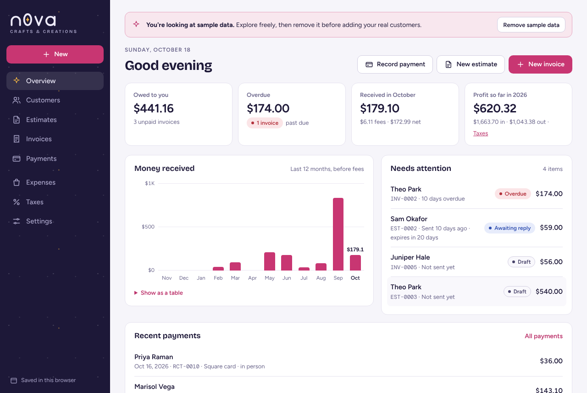
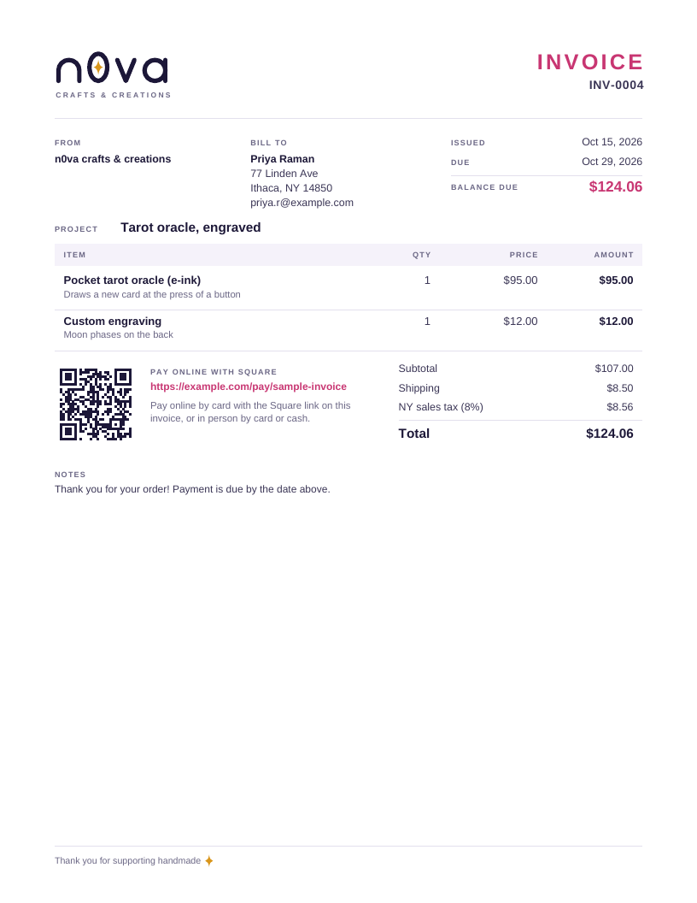
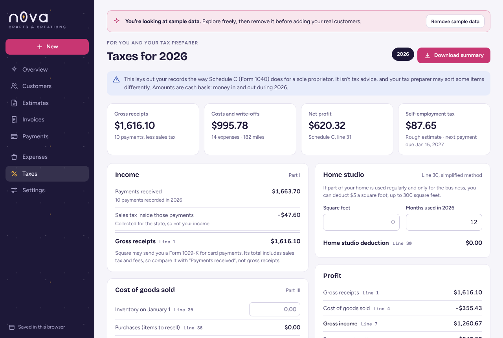
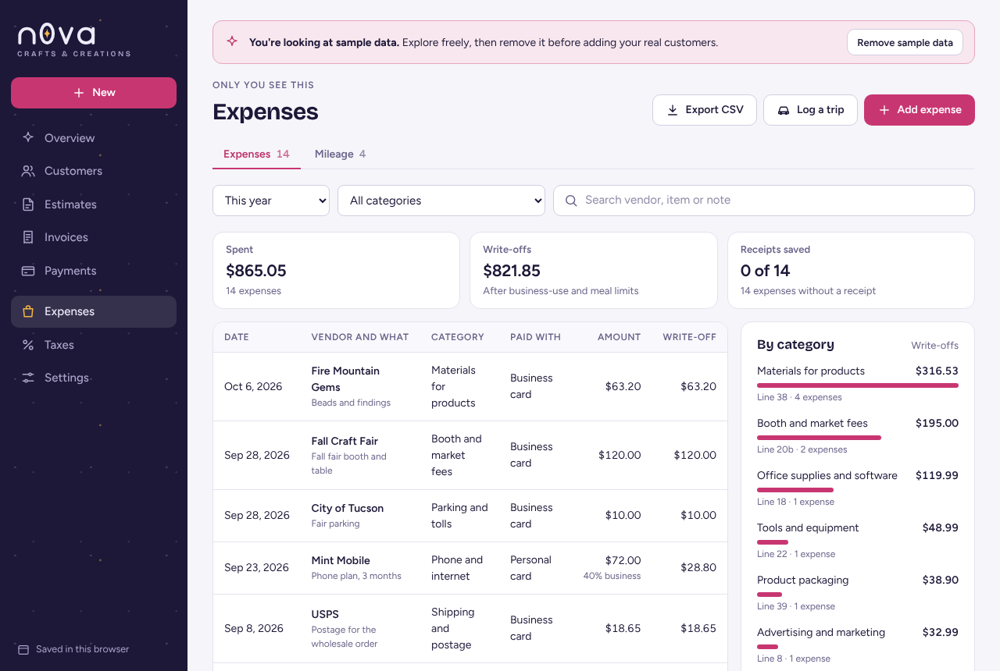

# n0va Books

Bookkeeping for **n0va crafts & creations**: customer profiles, estimates, invoices,
payments and receipts, plus expenses, mileage, sales tax and a tax-time summary, all
carrying the n0va brand. It's built for a maker who takes payments through Square:
Square moves the money, and n0va Books keeps the books, issues the documents and tracks
who owes what.



## What it does

* **Customers.** Name, business, email, phone, social handle, shipping address, tags
  (wholesale, market regular…), private notes (ring sizes, allergies) and the sales tax
  rate that applies to them. Each profile shows what they owe, what they've paid and every
  estimate, invoice and payment.
* **Estimates.** Line items, discounts, shipping, sales tax and an optional deposit
  ("50% to start"). Mark them accepted or declined, then **turn one into an invoice** in
  one click.
* **Invoices.** Payment terms, due dates, partial payments and overdue tracking. Paste a
  **Square payment link** and it prints on the invoice as a clickable link and a QR code.
  Void an invoice instead of deleting it to keep your numbering clean.
* **Payments and receipts.** Record each payment, whether by Square card, cash, check or
  anything else, with the Square receipt or transaction ID. The app estimates Square's
  processing fee and issues a numbered receipt (RCT-0001, RCT-0002…) that you can
  download or send.
* **Sales tax profiles.** Save the rates you collect, such as Arizona for a Tucson market
  or Oregon at 0%, and pick one for each customer or document. Documents keep the rate
  they were made with.
* **Expenses.** Log what the business spends in categories that follow Schedule C
  (materials, booth fees, shipping, tools, phone and internet, meals…), with the
  business share of things you also use personally and photos or PDFs of the receipts.
* **Mileage log.** Log the miles you drive for the business. Each trip is valued at the IRS
  standard mileage rate for its date.
* **Taxes.** A year-end page for you and your tax preparer: gross receipts without the
  sales tax, cost of goods sold, expenses by Schedule C line, the home-studio deduction,
  net profit, a rough self-employment tax estimate with the quarterly due dates, and the
  sales tax you collected by profile and quarter. Download it as a CSV.
* **Branded documents.** Download any estimate, invoice or receipt as a PDF with the n0va
  wordmark (or your own logo), your brand color, a QR code for paying online and a
  "PAID" or "RECEIVED" stamp when it applies. A ready-to-send message for each one is a
  click away.
* **Overview.** What you're owed, what's overdue, money received this month (before and
  after fees), profit so far this year, a 12-month chart and a "needs attention" list
  (overdue invoices, invoices due soon, estimates waiting on a reply, drafts).
* **Your data.** One-file backups (receipt photos included), restore, and CSV exports of
  customers, estimates, invoices, payments, expenses and mileage for your accountant.



## Two ways to use it

**Hosted on claude.ai (easiest).** Claude published a private copy to your claude.ai
account. Open it from your artifacts (in Claude Code, run `/artifacts`). Your books and
receipt photos are saved in that copy's private storage, so they're there on your phone
and your computer whenever you're signed in. Only you, and anyone you give edit access,
can see them. PDFs and backups download through a save prompt. Printing isn't available
there, so use the PDFs.

**Your own copy (works offline).** Download this `bookkeeping` folder and open
`index.html` in Chrome, Edge, Firefox or Safari. Nothing to install. Your books and receipt
photos are saved in that browser on that device, and you can also print documents
directly. To use it from anywhere, host the folder on any static site host (GitHub Pages,
Netlify, Cloudflare Pages). Each browser keeps its own books, so:

> **Download a backup regularly** (Settings → Backup and data) and keep it somewhere safe,
> like a cloud drive. The overview reminds you after 30 days. Clearing your browser's site
> data deletes books saved in the browser. Backups include receipt photos, so they grow
> as you add them.

The hosted copy and your own copy keep separate books. To move between them, download a
backup from one and restore it in the other.

## Working with Square

1. **Quote a custom order.** Create an estimate with a deposit. Download the PDF, or copy
   the ready-made message, and send it.
2. **Customer says yes.** Open the estimate and choose **Turn into invoice**.
3. **Get paid.** In Square, create a payment link (Square Dashboard → Online checkout →
   Payment links) for the deposit or the full amount and paste it into the invoice. The
   PDF shows it as a link and a QR code. Or take the card in person with Square as usual.
4. **Record it here.** On the invoice, choose **Record payment**. The amount fills in with
   the balance, or tap the deposit amount. Pick the Square method, paste the Square
   receipt number, and save. That issues the receipt and updates the balance.
5. **Market sales** don't need an invoice: record a payment with no invoice, pick the sales
   tax profile for where you sold, and add a customer only if you want to.

Fees are **estimates** from the rates in Settings → Payment methods. The defaults are
Square's US Free-plan rates as of January 2026: 2.6% + 15¢ in person, 3.3% + 30¢ online
and invoices, 3.5% + 15¢ keyed in, 1% (minimum $1) bank transfer. If you're on Square
Plus or Premium, or outside the US, change them to match. Your Square Dashboard has the
exact fee for every payment, and you can type it in.

## Sales tax

Settings → **Sales tax profiles** holds your saved rates. Two come ready:

* **Oregon (no sales tax)** at 0%. Oregon has no state or local sales tax.
* **Arizona (state rate only)** at 5.6%. Arizona's transaction privilege tax adds county
  and city rates on top, so most places charge more: Tucson's combined rate is about 8.7%.
  Look up the combined rate for each place you sell (the Arizona Department of Revenue has
  a rate lookup) and save a profile for each, like "Tucson 8.7%".

Choose the profile new estimates and invoices start with, and give a customer their own
profile to use theirs instead. Tick **Tax shipping** on a profile if that place taxes
delivery charges. If you change a profile's rate later, documents you already made keep
their old rate, and the editor offers to switch to the new one.

For market sales, record a payment without an invoice and pick the profile: the app works
out the tax inside the total (a $108.70 sale at 8.7% includes $8.70 of tax).

Taxes → **Sales tax collected** totals what you collected for each profile, for the whole
year or one quarter, to help with your sales tax returns. Invoices count on their issue
date (drafts and void invoices are left out) and market sales on the day you record them.

## Expenses, mileage and taxes



**Expenses.** Add each purchase with its date, amount, vendor and category. The
categories follow the lines of Schedule C (Form 1040), the form a sole proprietor files
for business income, so your preparer can copy the totals across. A few rules are built in:

* **Business use.** For something you also use personally, like your phone plan, enter
  the business share. Only that part counts.
* **Meals** count at 50%.
* **Materials, things you resell and packaging** go to cost of goods sold, not expenses.
* Attach **receipt photos or PDFs** straight from your phone's camera. Photos are shrunk
  to save space.



**Mileage.** Log each business trip: markets, supply runs, the post office. Each trip uses
the IRS standard mileage rate for its date: 70¢ a mile for 2025, 72.5¢ for January to June
2026 and 76¢ from July 1, 2026. When the IRS announces a new rate, add it in Settings →
Mileage rates. The standard rate covers gas, repairs and wear, so don't also log those
as expenses. Parking and tolls are deducted separately.

**Taxes.** Pick a year to see it laid out like Schedule C:

* **Income**: payments received, less the sales tax inside them. If Square sends you a
  Form 1099-K, its total includes sales tax and fees, so compare it with payments received.
* **Cost of goods sold**: enter your inventory, at cost, on January 1 and December 31.
* **Expenses** by line, including Square's processing fees and your mileage.
* **Home studio**: the simplified method, $5 a square foot for up to 300 square feet used
  regularly and only for the business.
* **Net profit** and a rough **self-employment tax** estimate (15.3% of 92.35% of net
  profit, once that reaches $400), with the quarterly estimated-tax due dates.
* **Sales tax collected** by profile and quarter, and a checklist of records to keep.

**Download summary** saves the page as a CSV for your tax preparer.

> This is record keeping, not tax advice. Amounts are cash basis (money in and out during
> the year), and your tax preparer may sort some items differently.

## Make it yours

Settings → **Logo and colors**: keep the n0va wordmark (the 0 is a ring holding a star),
upload your own logo (PNG, JPG or SVG), or use your business name as text. Pick a brand
color; buttons, highlights and document titles follow it, and the app keeps text readable
in light and dark mode. Settings → **Business details** fills the "From" block on every
document; **Estimates and invoices** sets currency, paper size (Letter or A4), payment
terms, the name printed on the tax line, default notes and numbering (prefixes and the
next number, which only ever goes up so no number is used twice).

## For developers

Plain HTML, CSS and JavaScript: no framework and no build step. Scripts load as classic
scripts, so `index.html` also works opened from disk.

```
index.html            the app shell
app.css               all styles (tokens at the top; print styles at the end)
js/util.js            money in integer cents, local dates, CSV
js/calc.js            totals, invoice and estimate status, fees, monthly rollups (pure)
js/tax.js             expense categories, Schedule C lines, mileage rates, the tax year (pure)
js/store.js           storage: claude.ai db and file storage when hosted, IndexedDB otherwise,
                      memory as a last resort
js/brand.js           the n0va wordmark as SVG and as jsPDF vector paths, brand color tokens
js/sheet.js           estimates, invoices and receipts as on-screen paper, plus message templates
js/pdf.js             the same documents as vector PDFs (jsPDF)
js/views/*.js         overview, customers, estimates and invoices, payments, expenses and
                      mileage, taxes, settings
js/app.js             navigation, menus, boot
vendor/               jsPDF and qrcode-generator (MIT, see vendor/README.md)
tests/*.test.js       unit tests for the money and tax math
scripts/build-hosted.mjs  builds the claude.ai-hosted copy
```

Run the tests with `node --test bookkeeping/tests/*.test.js` (Node 18 or later).
Amounts are stored as integer minor units (cents) and rounded half away from zero.

The hosted database holds up to 25,000 records in all, which is years of invoices for a
small studio. If it ever fills up, download a backup and archive old records.

## Ideas for what to add next

* **A product catalog** with material costs and stock counts, to see your margin on each
  piece, know what to restock before a market and fill in the inventory counts at tax time.
* **Square CSV import**: load the transactions export from your Square Dashboard and match
  each one to an invoice, so nothing slips through.
* **Bank and card imports**: load your statement as a CSV and only pick a category for
  each expense.
* **Market report**: booth fee, miles, expenses and sales for each event side by side, to
  see which markets are worth it.
* **Custom-order stages** (deposit paid → in progress → ready → shipped) with due dates and
  design photos.
* **Refunds, store credit and gift cards.**
